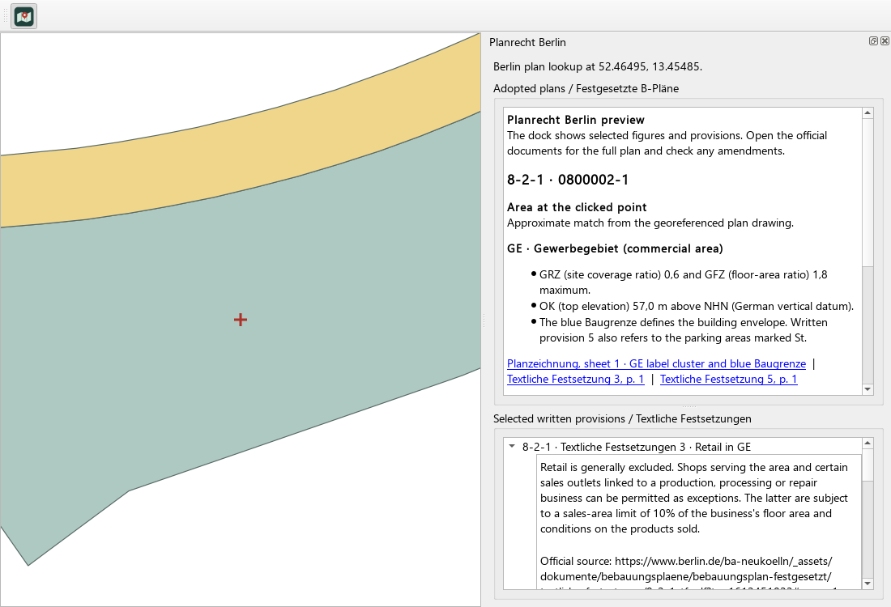

# Planrecht Berlin for QGIS

Planrecht Berlin is a standalone experimental QGIS plugin. Version 0.1.2 installs from
`planrecht_berlin-0.1.2.zip` and appears as **Planrecht Berlin** in the Plugin Manager,
toolbar and results dock.



## Install and try it

1. In QGIS, open **Plugins → Manage and Install Plugins → Install from ZIP** and choose
   `planrecht_berlin-0.1.2.zip`.
2. Activate **Planrecht Berlin** and click in Berlin. Try **52.46494611, 13.45485200**
   (latitude, longitude) for the commercial area of 8-2-1 or **52.46527898, 13.45485087**
   for the Grenzallee road area.
3. Open the linked official documents for the full provisions and any amendments. If
   Berlin rate-limits a PDF, use the dock's **Official plan page** link.

## What a click shows

1. Check the click against the bundled ALKIS Berlin state boundary, then query Berlin's
   adopted B-Plan WFS with the clicked coordinates and keep each plan whose
   official outline intersects the point.
2. For plan 8-2-1 as adopted on 22 May 2019, compare the point to the GE and Grenzallee
   polygons derived from the published drawing. An interior GE click shows the labelled
   figures and links to the drawing and written provisions 3 and 5. A Grenzallee click shows the
   public road designation and links to provision 7. The location block also points to the
   motorway information on the drawing.
3. When the point is within 2 m of a drawn boundary, the dock withholds area-specific figures
   to avoid assigning the wrong area and asks the user to check the drawing. A missing geometry
   file or a point that matches no single area also leads to the source documents for
   checking. For all three reviewed plans, a missing or different adoption date suppresses
   the curated figures and provisions. The live plan links remain available.
4. When several adopted plans intersect the point, the dock flags them before the summaries.
   The official documents show the full set of provisions and amendments.

The local state boundary comes from the Berlin Senate's **ALKIS Berlin Landesgrenze** WFS
under Datenlizenz Deutschland – Zero – Version 2.0. The bundled GeoJSON is the geometry
from layer `alkis_land:landesgrenze`, requested in EPSG:4326 on 15 November 2026. Its
coordinates, islands and interior ring are preserved. It is used only to route city lookups.
[Dataset and licence](https://daten.berlin.de/datensaetze/alkis-berlin-landesgrenze-wfs-07b1347b)

The WFS provides the plan outline and status. The area geometry represents the internal
designations on the published sheet and is approximate. The 2 m margin is a product choice for
ambiguous clicks. It is larger than the observed fit residual and does not establish survey
accuracy. Berlin directs users to the original or certified plan for binding information.
[Berlin's guidance on plan copies](https://www.berlin.de/sen/stadtentwicklung/planung/bebauungsplanverfahren/bebauungsplanverfahren-in-berlin/bebauungsplaene-online/)

## How the 8-2-1 geometry was built

The public `plu_bplan` WFS capabilities advertised plan and documentation records. The geometry
used here comes from the GE grey fill and the Grenzallee yellow fill on page 1 of the district's
vector PDF. Berlin's `bplan:b_bp_fs` feature with `planid=0800002-1` supplies the reference outline
in EPSG:25833 (ETRS89 / UTM zone 33N). The drawing checksum is recorded below.
[Adopted plan and documents](https://www.berlin.de/ba-neukoelln/politik-und-verwaltung/aemter/stadtentwicklungsamt/stadtplanung/bebauungsplaene/bebauungsplan-festgesetzt/artikel.140405.php) ·
[Official WFS polygon](https://gdi.berlin.de/services/wfs/bplan?service=WFS&version=2.0.0&request=GetFeature&typeNames=bplan%3Ab_bp_fs&outputFormat=application%2Fjson&srsName=EPSG%3A25833&CQL_FILTER=planid%3D%270800002-1%27)

PyMuPDF extracted the paths as PDF page coordinates in points, with the origin at the upper
left. The GE fill was path 1076 and the road fill was path 1075 in the zero-based
`page.get_drawings()` output for the source PDF. The paths share the boundary between
the two uses. The wide grey perimeter printed over both fills was used for visual orientation.

Fit the affine transform from the five rows marked **Fit** using least squares with an intercept.
The other three corners serve as checks. The vertex index is zero-based in the exterior ring
of the WFS polygon from the request above.

| PDF x | PDF y | WFS vertex | Use |
|---:|---:|---:|---|
| 1581.48 | 1059.72 | 0 | Fit |
| 1574.88 | 1063.44 | 1 | Check |
| 1549.56 | 1023.84 | 2 | Fit |
| 1098.12 | 1143.60 | 22 | Fit |
| 1098.48 | 1190.40 | 24 | Check |
| 1204.92 | 1406.76 | 58 | Fit |
| 1646.04 | 1120.80 | 84 | Fit |
| 1602.24 | 1063.68 | 86 | Check |

Close both fill paths, sample the GE curve into eight segments, transform the vertices into
EPSG:25833, then convert to WGS 84 with QGIS. The largest residual at the three check corners
was 0.034 m and the maximum distance from a WFS outline vertex to an extracted area boundary
was 0.035 m. The derived areas are 10,927.6 m² for GE and 2,830.6 m² for the road.
The district's rounded figures are 10,930 m² and 2,830 m². QGIS validated both polygons and
measured less than 0.01 m² of overlap along the shared boundary.
[District explanatory report, section 3.8, p. 49](https://www.berlin.de/ba-neukoelln/_assets/dokumente/bebauungsplaene/bebauungsplan-festgesetzt/begruendung/begruendung_8-2-1.pdf#page=49)

The [GeoJSON](planrecht_berlin/data/8-2-1-areas.geojson) can be opened in QGIS. The
[plan records](planrecht_berlin/data/plans.json) hold adoption and review dates, source
links, area labels, figures, and written provision references. The ZIP includes both. Point containment uses
the GeoJSON rings and segment distances in local metres, with no additional runtime library.

## Reviewed PDF checksums

The repository records SHA-256 checksums for the public PDFs used in the review.

| Plan document | SHA-256 |
|---|---|
| 3-9 drawing | `d11e0a4be99e0c2fb9fe493ff6abd14699ea6a2607cf0bc356d2bc58fb7ba7f0` |
| 5-8 drawing | `bed25a68bbadf32fc62355b9a7cc7741a90c6bb1496256d7e2b2d4e6fc5565be` |
| 8-2-1 drawing | `73402d62127e2a080f6bd16a50953f1d22175e6c0f0c5f8f09577efedfb4ac42` |
| 8-2-1 written provisions | `b5e43dffea5a262c18b2045230f7b13d201e617364e04de61c6a29e4ce85711a` |

QGIS's scanner flagged these strings in the 0.1.0 install ZIP. Version 0.1.1 keeps
the checksums here for auditing and ships the source links and adoption dates.

## Build and verify

From the repository root:

```sh
python build_plugin.py
python -m pytest -q tests
```

The build writes `dist/planrecht_berlin-0.1.2.zip`. Set `RUN_LIVE_BERLIN=1` to enable
the live WFS test. To test the actual ZIP in QGIS, run the following with QGIS's bundled
Python. Set `QT_QPA_PLATFORM=offscreen` for headless use. The smoke test loads the ZIP in
a temporary plugin directory and profile.

```sh
python smoke_qgis.py dist/planrecht_berlin-0.1.2.zip
```

The standalone preview was tested in QGIS 3.44.15 LTR on Windows. To also check
the official PDF downloads from the current network, pass `--check-pdfs`. Berlin
occasionally returns HTTP 429 for plan PDFs. The smoke test checks that the dock
contains the expected links even when a separate download request is rate-limited.
The release passed 36 automated tests with the WFS enabled. The independent
Astra High review scored the standalone package 8.9/10.

## Publish

Push the source, tag the release (for example `v0.1.2`), and upload the matching
`planrecht_berlin-<version>.zip` using **Add version** on the Planrecht Berlin listing.
Use the build and test commands above for each release. Planrecht Berlin 0.1.0 and 0.1.1
were developed in the [Norme Milano repository](https://github.com/SaeedSabzeh/norme-milano);
this repository keeps that history.
[Planrecht Berlin on the QGIS Plugin Repository](https://plugins.qgis.org/plugins/planrecht_berlin/)

## Scope and privacy

The point-to-area lookup covers 8-2-1. Plans 3-9 and 5-8 have reviewed plan-level summaries.
For other adopted plans the dock links to the published documents. Building envelopes,
motorway protection areas and the interaction of overlapping plans require checking the
official sources. The tool provides planning guidance. It sends in-city click coordinates
to the Berlin public B-Plan WFS. Outside-Berlin clicks are handled locally.

Copyright (C) 2026 Saeed Sabzeh. The Python plugin is free software: you can
redistribute it and/or modify it under the terms of the GNU General Public License as
published by the Free Software Foundation, either version 2 of the License, or (at your
option) any later version (GPL-2.0-or-later). It comes with no warranty. See
[LICENSE](LICENSE). The Berlin state boundary and the public B-Plan WFS
use Datenlizenz Deutschland – Zero – Version 2.0. The reviewed records cite their source
plans and retain the version dates.
